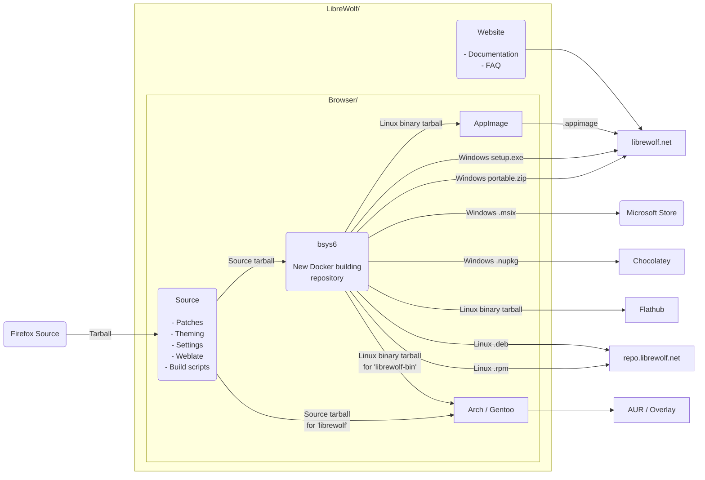

<div align="center">


# LibreWolf

**[English](./README.md)** | [Русский](./README.ru.md)

This repository contains all the patches and theming that make up LibreWolf,
as well as the LibreWolf preferences (in [settings/](./settings)) and the
scripts and Makefile to build LibreWolf.

</div>

> [!IMPORTANT]
> ## This is a fork of LibreWolf
>
> This repository is a **fork of [LibreWolf](https://librewolf.dev/librewolf/source)**,
> moved from Codeberg to GitHub so that development can continue here.
> Below is where the fork came from, which repositories it refers to, and what
> it changes. Details are in [FORK.md](./FORK.md).

## Where the fork came from

LibreWolf has changed hosting several times over its history. The full chain:

| Repository | Role | Link |
| --- | --- | --- |
| **`librewolf/source`** (librewolf.dev) | **Canonical upstream**, the project's main repository | <https://librewolf.dev/librewolf/source> |
| **`librewolf/source`** (Codeberg) | Mirror of the canonical repository | <https://codeberg.org/librewolf/source> |
| **`librewolf/bsys6`** (librewolf.dev) | Upstream build system | <https://librewolf.dev/librewolf/bsys6> |
| **`librewolf/bsys6`** (Codeberg) | Mirror of the build system | <https://codeberg.org/librewolf/bsys6> |
| `librewolf-community/browser/source` (GitLab) | The project's original home | <https://gitlab.com/librewolf-community/browser/source> |
| `librewolf-community/browser-linux` (GitHub) | The old GitHub home, archived and abandoned | <https://github.com/librewolf-community/browser-linux> |
| **`KosenkovPro/librewolf-source`** | **This fork** | <https://github.com/KosenkovPro/librewolf-source> |
| **`KosenkovPro/librewolf-bsys6`** | Fork of the build system | <https://github.com/KosenkovPro/librewolf-bsys6> |

The project's history: first GitHub (`librewolf-community`), then GitLab, then
Codeberg, and finally its own Forgejo instance at `librewolf.dev`. The old GitHub
and GitLab repositories are archived and no longer receive commits.

## What this fork changes

The fork was created with **full history** — 2338 upstream commits, 247 tags and 40
branches came across in one change, so the entire project history is available and
any upstream commit can be found.

These are the differences from upstream, all added by the fork:

| File | Purpose |
| --- | --- |
| [`FORK.md`](./FORK.md) | Fork description: upstream table, sync commands, build instructions, CI settings |
| [`.github/workflows/sync-upstream.yml`](./.github/workflows/sync-upstream.yml) | GitHub Actions workflow: fetches upstream changes daily and opens a pull request |
| [`.github/workflows/source-release.yml`](./.github/workflows/source-release.yml) | GitHub Actions workflow: builds the source archive and publishes it as a GitHub release |
| [`.github/workflows/build-images.yml`](./.github/workflows/build-images.yml) | GitHub Actions workflow: builds the build environments and pushes them to GHCR |
| [`.github/workflows/source-target-test.yml`](./.github/workflows/source-target-test.yml) | GitHub Actions workflow: test builds for Linux, Windows and macOS |
| [`.github/workflows/ci.yml`](./.github/workflows/ci.yml) | GitHub Actions workflow: checks the scripts and the workflow files |

The Dockerfiles in [`docker/`](./docker) take a `SOURCE_URL` build argument, so the images
can take the source archive from a GitHub release instead of the Forgejo package registry.

The **CI is ported from Forgejo to GitHub Actions**:

- upstream builds inside the `librewolf.dev/librewolf/buildenv:*` containers on its own
  runners and publishes the artefacts to S3 and to the Forgejo Package Registry;
- the fork builds the same images from the Dockerfiles in [`docker/`](./docker) and pushes
  them to `ghcr.io/kosenkovpro/buildenv:*`, and the source archive and the packages are
  published as GitHub releases.

A full Firefox build needs a lot of CPU time: the standard runners have four cores, so
the build fits on their disk but takes many hours. Set the repository variable
`BUILD_RUNNER_JSON` to a self-hosted or a larger runner to make it faster. The details
are in [`FORK.md`](./FORK.md).

Development continues here: new patches, settings and theming land in this repository, and
the upstream changes arrive through the same sync workflow.

The original `.forgejo/workflows/` are kept as they are — they are needed for
comparison against upstream and do not interfere with GitHub Actions.

## Syncing with upstream

```bash
git fetch upstream                       # fetch changes from Codeberg
git log --oneline HEAD..upstream/main    # see what changed
git merge upstream/main                  # merge upstream into your branch
git push origin main                     # push the result to this fork
```

Regular syncing happens automatically: the workflow opens a pull request that you
review and merge by hand — nothing is applied blindly.

## Infra

### Overview



### Packages

These are the locations where people have their repositories and build artifacts.

Active:

- [Arch](https://archlinux.org/packages/extra/x86_64/librewolf/) - Arch Linux package
- [BSYS6](https://librewolf.dev/librewolf/bsys6) - Linux Mint, Fedora,
  Ubuntu, MacOS, portable and setup for Windows
- [Gentoo](https://codeberg.org/librewolf/gentoo) - Gentoo GNU/Linux package

Downstream:

- [Alpine Linux](https://pkgs.alpinelinux.org/packages?name=librewolf&arch=)

### Forks

Previous:

- [CachyOS Browser](https://github.com/cachyos/cachyos-browser-settings)
- [FireDragon Browser](https://github.com/dr460nf1r3/firedragon-browser)

## Build

There are two ways to build LibreWolf.
You can either use the source tarball
or compile directly with this repository.

### Build: Tarball

1. Let's **[download the latest tarball](https://librewolf.dev/librewolf/source/releases)**.
   This tarball is the latest produced by the [CI](https://librewolf.dev/librewolf/source/actions?workflow=source-release.yaml).
   You can also check the `sha256sum` of the tarball there:

   ```bash
   tar xf <tarball>
   cd <folder>
   ```

2. Then, you have to bootstrap your system to be able to build LibreWolf.
   You only have to do this one time.
   It is done by running the following command:

   ```bash
   ./mach --no-interactive bootstrap --application-choice=browser
   ```

3. Build LibreWolf and then package or run it with the following commands:

   ```bash
   ./mach build && ./mach package
   # or
   ./mach build && ./mach run
   ```

   > [!NOTE]
   >
   > To get all parameters of `./mach`, use:
   >
   > ```bash
   > ./mach configure -- --help | less
   > ```

### Build: Repository

1. Clone this repository with Git:

   ```bash
   git clone --recursive https://github.com/KosenkovPro/librewolf-source.git librewolf-source && cd librewolf-source
   ```

2. Build LibreWolf source code,
   also you have to bootstrap your system to be able to build LibreWolf.
   You only have to do this one time.

   ```bash
   make dir && make bootstrap
   ```

3. Package LibreWolf or run it with the following commands:

   ```bash
   make build && make package
   # or
   make build && make run
   ```

## Translations

We use Weblate to localize all LibreWolf-specific strings.
You can help us by translating LibreWolf into your language at
<https://translate.codeberg.org/engage/librewolf>.
Here is the current translation status:

<a href="https://translate.codeberg.org/engage/librewolf/">
  
</a>

## Development

### Development: Creating a patch

The easiest way to make patches is to go to the LibreWolf source folder:

```bash
cd librewolf-$(cat version)
git init
git add <path_to_file_you_changed>
git commit -am initial-commit
git diff > ../mypatch.patch
```

We have Gitter / Matrix rooms,
and on the website we have links to the various issue trackers.

### Development: Existing patches

The easiest way to make patches is to go to the LibreWolf source folder:

```bash
make fetch
./scripts/git-patchtree.sh patches/sed-patches/disable-pocket.patch
```

Now change the source tree the way you want,
keeping in mind to `git add` new files.
When done, you can create the new patch with:

```bash
cd firefox-<version>
git diff 4b825dc642cb6eb9a060e54bf8d69288fbee4904 HEAD > ../my-patch-name.patch
```

This ID is the hash value of the first commit, which is called `initial`.
Don't forget to commit changes before doing this diff,
or the patch will be incomplete.

### Development: Creating a patch for problems in Mozilla's [Bugzilla](https://bugzilla.mozilla.org)

Well, first of all:

- [Create an account](https://bugzilla.mozilla.org/createaccount.cgi).
- Handy link: [Bugs Filed Today](https://bugzilla.mozilla.org/buglist.cgi?cmdtype=dorem&remaction=run&namedcmd=Bugs%20Filed%20Today&sharer_id=1&list_id=15939480).
- The essential: [Firefox Source Tree Documentation](https://firefox-source-docs.mozilla.org/).

Now that you have a patch in LibreWolf, that's not enough to upload to Mozilla.
See, Mozilla only accepts patches against Nightly.
So here is how to do that:

1. If you have not done so already,
   create the `mozilla-unified` folder and build Firefox with it:

   ```bash
   hg clone https://hg.mozilla.org/mozilla-unified && cd mozilla-unified
   hg update
   MOZBUILD_STATE_PATH=$HOME/.mozbuild ./mach --no-interactive bootstrap --application-choice=browser
   ./mach build
   ./mach run
   ```

2. If you skipped the previous step, you could ensure that you're up to date with:

   ```bash
   cd mozilla-unified
   hg pull && hg update
   ```

3. Now you can apply your patch to Nightly:

   ```bash
   patch -p1 -i ../mypatch.patch
   ```

4. Now, let Mercurial create the patch:

   ```bash
   hg diff > ../my-nightly-patch.patch
   ```

5. After this, it can be uploaded to Bugzilla.

#### Development: Contributing

Time to start hacking! You should join us on [Matrix](https://chat.mozilla.org),
say hello in the [Introduction channel](https://chat.mozilla.org/#/room/#introduction:mozilla.org),
and [find a bug to start working on](https://codetribute.mozilla.org).
See the [Firefox Contributors' Quick Reference](https://firefox-source-docs.mozilla.org/contributing/contribution_quickref.html#firefox-contributors-quick-reference)
to learn how to test your changes,
send patches to Mozilla,
update your source code locally, and more.

## MacOS and Windows

We understand, life isn't always fair 😺.
The same steps as above apply you will just have to walk through
the beginning part of the guides for:

- [MacOS](https://firefox-source-docs.mozilla.org/setup/macos_build.html):
  The cross-compiled Mac `.dmg` files are somewhat new.
  They should work, perhaps with the exception of the `make setup-wasi` step.
- [Windows](https://firefox-source-docs.mozilla.org/setup/windows_build.html):
  Building on Windows is not very well tested.

Help with testing these targets is always welcome.
