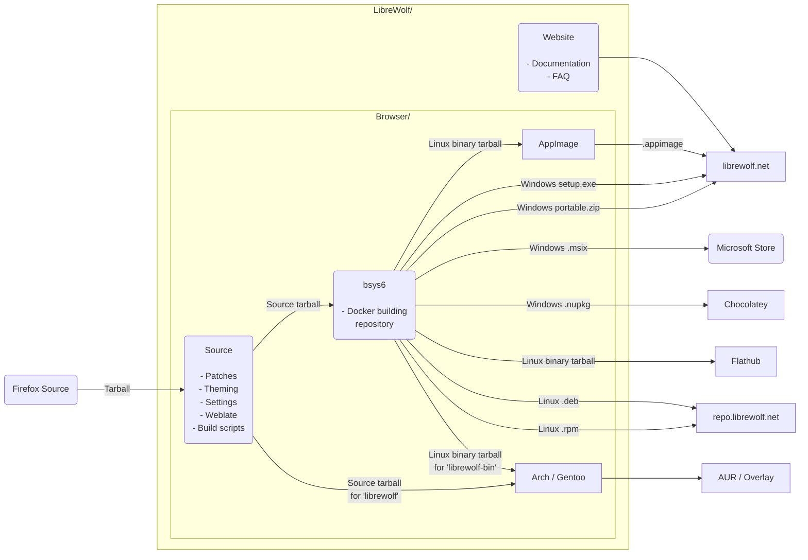

<div align="center">


# LibreWolf

[English](./README.md) | **[Русский](./README.ru.md)**

Этот репозиторий содержит все патчи и оформление, из которых состоит LibreWolf,
а также настройки LibreWolf (в каталоге [settings/](./settings)), скрипты и Makefile
для сборки LibreWolf.

</div>

> [!IMPORTANT]
> ## Это форк LibreWolf
>
> Этот репозиторий — **форк [LibreWolf](https://librewolf.dev/librewolf/source)**,
> перенесённый с Codeberg на GitHub, чтобы продолжить разработку проекта здесь.
> Ниже описано, откуда взялся форк, на какие репозитории он ссылается и что в нём
> изменено. Подробности — в [FORK.md](./FORK.md).

## Откуда взялся форк

LibreWolf за свою историю сменил несколько хостингов. Полная цепочка репозиториев:

| Репозиторий | Роль | Ссылка |
| --- | --- | --- |
| **`librewolf/source`** (librewolf.dev) | **Каноничный upstream**, основной репозиторий проекта | <https://librewolf.dev/librewolf/source> |
| **`librewolf/source`** (Codeberg) | Зеркало каноничного репозитория | <https://codeberg.org/librewolf/source> |
| **`librewolf/bsys6`** (librewolf.dev) | Upstream системы сборки | <https://librewolf.dev/librewolf/bsys6> |
| **`librewolf/bsys6`** (Codeberg) | Зеркало системы сборки | <https://codeberg.org/librewolf/bsys6> |
| `librewolf-community/browser/source` (GitLab) | Первоначальное размещение проекта | <https://gitlab.com/librewolf-community/browser/source> |
| `librewolf-community/browser-linux` (GitHub) | Старое размещение на GitHub, архивное и заброшенное | <https://github.com/librewolf-community/browser-linux> |
| **`KosenkovPro/librewolf-source`** | **Этот форк** | <https://github.com/KosenkovPro/librewolf-source> |
| **`KosenkovPro/librewolf-bsys6`** | Форк системы сборки | <https://github.com/KosenkovPro/librewolf-bsys6> |

История проекта: сначала GitHub (`librewolf-community`), затем GitLab, затем Codeberg,
и наконец собственный Forgejo-инстанс на `librewolf.dev`. Старые репозитории на GitHub
и GitLab заархивированы и новых коммитов не получают.

## Что изменено в этом форке

Форк создан с **полной историей** — 2338 коммитов upstream, 247 тегов и 40 веток
перенесены одним изменением, так что история проекта доступна целиком и любой
upstream-коммит можно найти.

На данный момент отличий от upstream ровно два, оба добавлены форком:

| Файл | Назначение |
| --- | --- |
| [`FORK.md`](./FORK.md) | Описание форка: таблица upstream, команды синхронизации, сборка |
| [`.github/workflows/sync-upstream.yml`](./.github/workflows/sync-upstream.yml) | Workflow GitHub Actions: раз в сутки забирает изменения с upstream и открывает pull request |

Планируемые изменения:

- **Перенос CI с Forgejo на GitHub Actions.** Upstream собирает в контейнерах
  `librewolf.dev/librewolf/buildenv:*` на собственных раннерах и публикует артефакты
  в S3 и Package Registry Forgejo. Форк собирает те же образы из Dockerfile-ов
  в каталоге [`docker/`](./docker) и публикует их в GHCR, а тест-сборки и релиз
  source-тарбола переводит на GitHub Actions и GitHub Releases.
- **Развитие проекта ведётся здесь.** Новые патчи, настройки и темы вносятся
  в этот репозиторий; изменения из upstream приезжают через тот же
  workflow синхронизации.

Оригинальные `.forgejo/workflows/` сохранены как есть — они нужны для сверки
с upstream и не мешают GitHub Actions.

## Синхронизация с upstream

```bash
git fetch upstream                       # забрать изменения с Codeberg
git log --oneline HEAD..upstream/main    # посмотреть, что изменилось
git merge upstream/main                  # влить upstream в свою ветку
git push origin main                     # отправить результат в этот форк
```

Регулярная синхронизация выполняется автоматически: workflow открывает pull request,
который нужно просмотреть и вручную слить — ничего не применяется вслепую.

## Инфраструктура

### Обзор



### Пакеты

Здесь находятся репозитории и артефакты сборки.

Активные:

- [Arch](https://archlinux.org/packages/extra/x86_64/librewolf/) — пакет для Arch Linux
- [BSYS6](https://librewolf.dev/librewolf/bsys6) — Linux Mint, Fedora,
  Ubuntu, macOS, portable и установщик для Windows
- [Gentoo](https://codeberg.org/librewolf/gentoo) — пакет для Gentoo GNU/Linux

Вторичные:

- [Alpine Linux](https://pkgs.alpinelinux.org/packages?name=librewolf&arch=)

### Форки

Предыдущие:

- [CachyOS Browser](https://github.com/cachyos/cachyos-browser-settings)
- [FireDragon Browser](https://github.com/dr460nf1r3/firedragon-browser)

## Сборка

Собрать LibreWolf можно двумя способами: использовать готовый source-тарбол
или компилировать напрямую из этого репозитория.

### Сборка: тарбол

1. **[Скачайте свежий тарбол](https://librewolf.dev/librewolf/source/releases)**.
   Это тарбол, который собирает [CI](https://librewolf.dev/librewolf/source/actions?workflow=source-release.yaml).
   Там же можно сверить `sha256sum` тарбола:

   ```bash
   tar xf <tarball>
   cd <folder>
   ```

2. Далее нужно подготовить систему к сборке LibreWolf.
   Это делается один раз:

   ```bash
   ./mach --no-interactive bootstrap --application-choice=browser
   ```

3. Соберите LibreWolf, а затем упакуйте или запустите:

   ```bash
   ./mach build && ./mach package
   # или
   ./mach build && ./mach run
   ```

   > [!NOTE]
   >
   > Полный список параметров `./mach`:
   >
   > ```bash
   > ./mach configure -- --help | less
   > ```

### Сборка: репозиторий

1. Клонируйте этот репозиторий:

   ```bash
   git clone --recursive https://github.com/KosenkovPro/librewolf-source.git librewolf-source && cd librewolf-source
   ```

2. Соберите исходники LibreWolf.
   Подготовку системы к сборке нужно выполнить один раз:

   ```bash
   make dir && make bootstrap
   ```

3. Упакуйте LibreWolf или запустите:

   ```bash
   make build && make package
   # или
   make build && make run
   ```

## Переводы

Все строки, специфичные для LibreWolf, локализуются в Weblate.
Перевести LibreWolf на свой язык можно на
<https://translate.codeberg.org/engage/librewolf>.
Текущее состояние переводов:

<a href="https://translate.codeberg.org/engage/librewolf/">
  
</a>

## Разработка

### Разработка: создание патча

Самый простой способ — перейти в каталог исходников LibreWolf:

```bash
cd librewolf-$(cat version)
git init
git add <path_to_file_you_changed>
git commit -am initial-commit
git diff > ../mypatch.patch
```

У проекта есть чаты в Gitter и Matrix,
а на сайте собраны ссылки на трекеры задач.

### Разработка: существующие патчи

Самый простой способ — перейти в каталог исходников LibreWolf:

```bash
make fetch
./scripts/git-patchtree.sh patches/sed-patches/disable-pocket.patch
```

Теперь меняйте дерево исходников так, как нужно,
не забывая делать `git add` для новых файлов.
Когда всё готово, патч создаётся так:

```bash
cd firefox-<version>
git diff 4b825dc642cb6eb9a060e54bf8d69288fbee4904 HEAD > ../my-patch-name.patch
```

Этот идентификатор — хеш первого коммита, который называется `initial`.
Не забудьте закоммитить изменения перед созданием diff, иначе патч получится неполным.

### Разработка: патч для проблем в [Bugzilla](https://bugzilla.mozilla.org/) Mozilla

Сначала:

- [Создайте аккаунт](https://bugzilla.mozilla.org/createaccount.cgi).
- Удобная ссылка: [Bugs Filed Today](https://bugzilla.mozilla.org/buglist.cgi?cmdtype=dorem&remaction=run&namedcmd=Bugs%20Filed%20Today&sortkey=priority&listing=1).
- Необходимое: [Firefox Source Tree Documentation](https://firefox-source-docs.mozilla.org/).

Патча в LibreWolf недостаточно, чтобы загрузить его в Mozilla.
Mozilla принимает патчи только против Nightly. Делается это так:

1. Если папка `mozilla-unified` ещё не создана,
   создайте её и соберите Firefox:

   ```bash
   hg clone https://hg.mozilla.org/mozilla-unified && cd mozilla-unified
   hg update
   MOZBUILD_STATE_PATH=$HOME/.mozbuild ./mach --no-interactive bootstrap --application-choice=browser
   ./mach build
   ./mach run
   ```

2. Если этот шаг пропущен, обновитесь:

   ```bash
   cd mozilla-unified
   hg pull && hg update
   ```

3. Теперь примените патч к Nightly:

   ```bash
   patch -p1 -i ../mypatch.patch
   ```

4. Пусть Mercurial создаст патч:

   ```bash
   hg diff > ../my-nightly-patch.patch
   ```

5. После этого его можно загрузить в Bugzilla.

#### Разработка: участие в проекте

Начинать можно прямо сейчас! Присоединяйтесь к [Matrix](https://chat.mozilla.org/),
поздоровайтесь в канале [Introduction](https://chat.mozilla.org/#/room/#introduction:mozilla.org)
и [найдите задачу, за которую хотите взяться](https://codetribute.mozilla.org).
Подробности о том, как проверять изменения, отправлять патчи в Mozilla
и обновлять исходники, — в
[Firefox Contributors' Quick Reference](https://firefox-source-docs.mozilla.org/contributing/contribution_quickref.html#firefox-contributors-quick-reference).

## macOS и Windows

Понимаем, не у всех одинаковые условия 😺.
Остальные шаги те же, что и выше, для платформ:

- [macOS](https://firefox-source-docs.mozilla.org/setup/macos_build.html):
  кросс-компиляция `.dmg` для Mac относительно новая,
  возможно, потребуется выполнить `make setup-wasi`.
- [Windows](https://firefox-source-docs.mozilla.org/setup/windows_build.html):
  сборка на Windows протестирована хуже всего.

Помощь с проверкой этих платформ всегда приветствуется.

## Лицензия

Исходный код распространяется на условиях Mozilla Public License v. 2.0.
Копию MPL можно получить на <http://mozilla.org/MPL/2.0/>.
